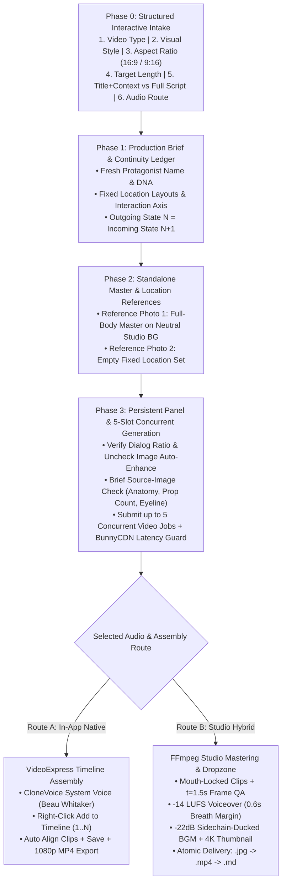

# 🎬 VideoExpress Dynamic Multi-Style Story & Shorts Agent

An autonomous, modular production agent for **VideoExpress.ai** (`https://app.videoexpress.ai/`) that turns either **Just a Title & Context** or a **Full Script** into a frame-continuous, broadcast-ready **Narrated Story Video (16:9)** or **YouTube Short / Reel (9:16)**.

Built from extensive hands-on production experience across **2D Stickman**, **3D Pixar**, **Photorealistic**, **2D Anime**, and **Claymation** workflows, this repository combines interactive upfront intake, strict character/location continuity locks, Backbone/jQuery DOM & 5-slot queue automation, and dual audio pipelines (**In-App CloneVoice TTS** + **Studio FFmpeg Sidechain Mastering**).

---

## 🏗️ Restructured Repository Hierarchy

```text
videoexpress-stickman-story-agent/
├── README.md                              # Architecture overview, intake guide, and quickstart
├── SYSTEM_PROMPT.md                       # Consolidated Master System Prompt (ready to load into any browser agent)
├── config/
│   ├── intake-schema.json                 # JSON Schema for the 6 interactive intake dimensions & defaults
│   └── prompt-book.schema.json            # JSON Schema for master references, fixed set layouts, continuity & mouth-lock
├── prompts/                               # Modular prompt specifications by production phase
│   ├── 01-intake-and-brief.md             # Phase 0: Interactive Intake (Video Type, Style, Ratio, Length, Title+Context vs Full Script)
│   ├── 02-story-and-continuity.md         # Phase 1–2: Multi-Style Art Direction, Master References, Handoff Ledger & Mouth-Lock
│   ├── 03-videoexpress-mechanics.md       # Phase 3–4: VideoExpress Modal DOM hooks, 5-slot Queue Poller & BunnyCDN Latency Guard
│   └── 04-audio-qa-and-delivery.md        # Phase 5–6: In-App CloneVoice vs Studio FFmpeg Sidechain BGM, Frame QA & Atomic Dropzone
├── scripts/                               # Battle-tested automation & post-production utilities
│   ├── ve_queue_worker.js                 # Browser 5-slot concurrent image2video queue worker & status poller
│   └── studio_audio_assembler.py          # Local FFmpeg 0px sync, -14 LUFS voice calibration, sidechain ducking & atomic delivery
├── templates/                             # Standardized markdown templates for runs
│   ├── production-brief.template.md       # Pre-execution Production Brief template
│   └── continuity-ledger.template.md      # Scene-by-scene Incoming -> Action -> Outgoing continuity & UUID ledger
├── evals/
│   └── acceptance-checklist.md            # End-to-end QA checklist covering Intake, Multi-Style, DOM Mechanics & Export
└── examples/
    ├── example-request-title-context.md   # Mode A: Just Title & Context -> Full autonomous story & storyboard
    ├── example-request-full-script.md     # Mode B: Full Script Provided -> Beat segmentation & 0.6s breath calibration
    ├── cat-knight-3d-pixar.md             # 20-shot 3D Pixar Widescreen story + sidechain orchestral audio example
    ├── continuous-cat-story.md            # Continuous action handoff storyboard example (Outgoing N = Incoming N+1)
    ├── beach-visit.md                     # 3D stylized coastal continuity & master character reference example
    ├── zoo-visit-2d.md                    # 14-clip 2D Stickman fixed-location layout & interaction axis example
    └── example-request.md                 # Classic quick-start request example
```

---

## ⚡ End-to-End Production Workflow



---

## 🎯 Phase 0: What the Agent Asks at Intake

When you start a new run, the agent checks which parameters you already provided and asks once for any missing choices:

| # | Dimension | Supported Options | Default (When Unspecified) |
| :-: | :--- | :--- | :--- |
| **1** | **Video Type** | `Narrated Story / Fable`, `YouTube Short / Reel`, `Explainer / Documentary`, `Comedy / Satire Skit` | `Narrated Story / Fable` |
| **2** | **Visual Style** | `2D Stickman`, `3D Pixar`, `Photorealistic`, `2D Anime / Illustration`, `Claymation` | `2D Stickman` *(or user choice)* |
| **3** | **Aspect Ratio** | `Landscape (16:9)` or `Vertical (9:16)` *(never `1:1`)* | `Landscape (16:9)` |
| **4** | **Target Length** | `Short (15–30s)`, `Standard (45–60s)`, `Extended (75–120s+)`, `Story-Driven Auto` | `Story-Driven Auto` (~3–5s/beat) |
| **5** | **Input Mode** | **Mode A: Just Title & Context** *(Agent writes script)* \| **Mode B: Full Script** *(Agent segments & calibrates)* | Inferred from user input |
| **6** | **Audio Route** | **Route A:** In-App CloneVoice (`Beau Whitaker`) \| **Route B:** Studio FFmpeg (`-14 LUFS` + Sidechain BGM + Dropzone) | **Route A** (`Beau Whitaker`) |

---

## 🛠️ Key Production Learnings Built Into This Agent

1. **Dialog Ratio & Auto-Enhance Reset Guard ([`prompts/03-videoexpress-mechanics.md`](prompts/03-videoexpress-mechanics.md)):**
   - The `Create Video From Prompt` modal has its own aspect-ratio toggle that can silently reset to `9:16` even inside a `16:9` project, and `Automatically enhance my image prompt` can re-check itself after a rerender. Both are verified before **every single `Create Image` submission**.
2. **BunnyCDN Packaging & `mediaPath` Sync Latency Guard:**
   - VideoExpress marks jobs `completed` / `SUCCEEDED` 10–25 seconds before BunnyCDN finishes packaging the `.mp4` at `https://cdn-ny-b.videoexpress.ai/video/<fileName>.mp4`. The agent polls until `mediaPath` is non-null and verified `> 1 MB`.
3. **Mouth-Locked Non-LipSync Prompts ([`prompts/02-story-and-continuity.md`](prompts/02-story-and-continuity.md)):**
   - For third-person narration or music-backed videos without LipSync HD, prompts establish a single closed-lip smile at frame 0, seal the lower face (`lips, jaw, chin, cheeks`), and route all emotion through eyes, eyebrows, head tilt, posture, and hands.
4. **Outgoing State $N$ = Incoming State $N+1$ Continuity:**
   - Every scene starts in the exact physical pose, location, and prop state where the prior scene ended—preventing neutral pose resets, premature prop completion (e.g., already-open umbrellas), and lens-staring characters.
5. **0.60s Breath Calibration & `-22dB` Sidechain Audio Ducking ([`scripts/studio_audio_assembler.py`](scripts/studio_audio_assembler.py)):**
   - In Studio Hybrid mode, narration is rate-calibrated (`+0%` to `+18%`) so every line finishes $\ge 0.60\text{s}$ before the shot cut, boosted at `3kHz` (`+3.5dB`), normalized to `-14 LUFS`, and paired with genre-matched BGM ducked via FFmpeg `sidechaincompress`.

---

## 🚀 Quickstart

1. Sign into **[VideoExpress.ai](https://app.videoexpress.ai/)** in your browser.
2. Load [`SYSTEM_PROMPT.md`](SYSTEM_PROMPT.md) into your browser-capable agent.
3. Provide either **Just a Title & Context** (see [`examples/example-request-title-context.md`](examples/example-request-title-context.md)) or a **Full Script** (see [`examples/example-request-full-script.md`](examples/example-request-full-script.md)) along with your desired Video Type, Visual Style, Aspect Ratio, and Length.
